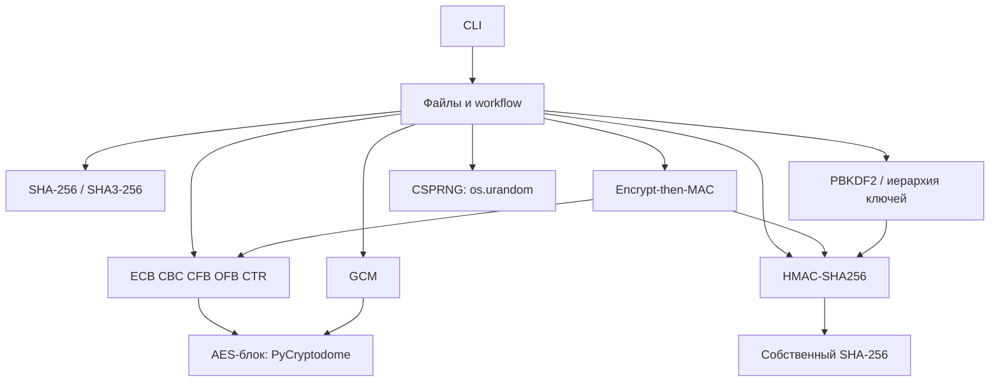

# Минимальная архитектура CryptoCore

Дата: 2026-11-06. Учебная библиотека и файловая CLI-утилита на Python 3.14 с поддержкой Windows. Модули С1–С3 реализованы; части С4–С8 ниже остаются проектом. Фактические результаты этапа будут отражены в STAGE1_AUDIT.md. [План](IMPLEMENTATION_PLAN.md) определяет порядок создания, [матрица](REQUIREMENTS_MATRIX.md) — обязательства, [реестр](REQUIREMENTS_CONFLICTS.md) — открытые вопросы.

## Границы приложения

Один устанавливаемый пакет `cryptocore` и console entry point `cryptocore = cryptocore.cli:main`. Используется `pyproject.toml` и layout `src/`. Два внешних интерфейса: CLI и небольшие функции/классы библиотеки. GUI, БД, сервер, сеть, плагины, отдельный сервис управления ключами и дополнительные криптоалгоритмы не нужны.

Обязательные возможности добавляются последовательно: AES-128 ECB → CBC/CFB-128/OFB/CTR → CSPRNG → SHA-256/SHA3-256 → HMAC-SHA256 → Encrypt-then-MAC/GCM → PBKDF2 и иерархия ключей → итоговая проверка. AES-256, BLAKE2b и CMAC в выбранный объём не входят; CMAC остаётся Could.

## Будущая структура

Схема включает реализованные модули С1–С3 и будущие С4–С8. Общие внутренние буферы режимов размещены в _padded.py, _stream.py и _common.py. Каталоги будущих спринтов не созданы.

```text
CryptoCore/
├── requirements/
│   ├── syllabus_scientific_ru.md
│   └── sprints/m1.md ... m8.md
├── REQUIREMENTS_MATRIX.md
├── REQUIREMENTS_CONFLICTS.md
├── IMPLEMENTATION_PLAN.md
├── ARCHITECTURE.md
├── .gitignore
├── pyproject.toml                  # С1: установка и CLI
├── README.md                      # С1, обновляется каждый спринт
├── src/cryptocore/
│   ├── __init__.py
│   ├── cli.py                     # С1: argparse, выбор операции, коды выхода
│   ├── file_io.py                 # С1: бинарные потоки и файловые workflow
│   ├── aes.py                     # С1: адаптер библиотечного AES-блока
│   ├── padding.py                 # С1: PKCS#7, только ECB/CBC
│   ├── modes/
│   │   ├── ecb.py                 # С1
│   │   ├── cbc.py                 # С2
│   │   ├── cfb.py                 # С2: CFB-128
│   │   ├── ofb.py                 # С2
│   │   ├── ctr.py                 # С2
│   │   └── gcm.py                 # С6: CTR, GHASH, GF(2^128)
│   ├── csprng.py                  # С3
│   ├── hash/
│   │   ├── sha256.py              # С4
│   │   └── sha3_256.py            # С4
│   ├── mac/hmac.py                # С5
│   ├── aead/encrypt_then_mac.py   # С6: композиция режима и HMAC
│   └── kdf/
│       ├── pbkdf2.py              # С7
│       └── hierarchy.py           # С7: derive_key, не полный HKDF
├── tests/
│   ├── unit/
│   ├── integration/
│   ├── vectors/                   # версионируемые несекретные KAT
│   └── run_tests.py               # одна команда запуска
├── docs/                          # С8
│   ├── API.md
│   ├── USERGUIDE.md
│   └── DEVELOPMENT.md
├── TESTING.md                     # процедура и результаты STS с С3
└── CHANGELOG.md                   # обязательно к С8
```

`__init__.py` добавляются в подпакеты при их создании. Каталог `src/cryptocore/hash` соответствует рекомендованному `src/hash`, но находится внутри устанавливаемого пространства имён из S8-DOC-3. `hierarchy.py` намеренно назван по реализуемой конструкции: рекомендованное в С7 имя `hkdf.py` не превращает её в HKDF стандарта RFC 5869.

## Ответственность и зависимости

| Компонент | Ответственность | Прямые зависимости |
| :-- | :-- | :-- |
| `cli` | Разбор/проверка аргументов по команде и спринту, декодирование hex, маршрутизация, stdout/stderr и exit code | `argparse`, `file_io`, публичные криптооперации |
| `file_io` | Чтение бинарных файлов чанками, разбор/запись IV/nonce/tag, текстовые результаты, временные файлы и публикация результата | стандартная библиотека, функции выбранной операции |
| `aes` | Шифрование/расшифрование **одного** блока 16 байт ключом 16 байт | только `Crypto.Cipher.AES` |
| `padding` | Дополнение и строгая проверка PKCS#7 | стандартная библиотека |
| `modes` ECB/CBC/CFB/OFB/CTR | Собственная учебная логика режимов, состояние между чанками | `aes`, для ECB/CBC — `padding` |
| `csprng` | Единая функция безопасных случайных байтов, обработка отказа | `os.urandom` |
| `hash` | Собственные SHA-256 и SHA3-256 с постоянным размером состояния | стандартная библиотека |
| `mac.hmac` | Собственный HMAC-SHA256 с ключами переменной длины | собственный `hash.sha256` |
| `modes.gcm` | Собственный GCM: inc32, GHASH, обработка AAD, полный тег | `aes`, собственные CTR/GHASH-операции |
| `aead.encrypt_then_mac` | Композиция шифрования и HMAC с независимыми ключами | `modes`, `mac.hmac` |
| `kdf` | Собственные PBKDF2-HMAC-SHA256 и контекстная иерархия | `mac.hmac` |

Криптографическое ядро не читает argv, не открывает пути и не печатает ключи/результаты. CLI не реализует раунды, padding или MAC. Работа с файлами не должна создавать циклических зависимостей: `file_io` получает операцию или контекст, ядро о файлах назначения не знает. Случайность запрашивает вызывающий workflow; ядро может принимать заданный IV/nonce для известных тестовых векторов. Это не разрешает пользовательский IV при CLI-шифровании.



## Минимальные контракты API

Это проектируемые контракты. Окончательные сигнатуры и исключения документируются и тестируются при реализации, а не считаются существующим API.

| Область | Контракт |
| :-- | :-- |
| AES | `encrypt_block(key: bytes, block: bytes) -> bytes`, `decrypt_block(key: bytes, block: bytes) -> bytes`; длины ключа/блока — 16 байт. Внутри разрешён библиотечный ECB только как поставщик независимого AES-блока. |
| PKCS#7 | `pad(data: bytes, block_size: int = 16) -> bytes`, `unpad(data: bytes, block_size: int = 16) -> bytes`; проверяются длина и каждый байт дополнения. Пустой plaintext получает полный блок padding. |
| Режимы | Контекст операции принимает ключ и IV, если применим; `update(data: bytes) -> bytes`, `finalize() -> bytes`. ECB/CBC удерживают только необходимый хвост, потоковые режимы сохраняют остаток гаммы между update. |
| CSPRNG | Заданная требованиями `generate_random_bytes(num_bytes: int) -> bytes`; никакого `random`. |
| Хеши | Классы `SHA256`, `SHA3_256`: `update(data: bytes) -> None`, `digest() -> bytes`, `hexdigest() -> str`. Хранится состояние, счётчик и неполный блок. Внешний hex — нижний регистр. |
| HMAC | `HMAC(key: bytes)` с `update`, `digest`, `hexdigest`; собственная SHA256, размер блока 64 байта. Нулевой/длинный ключ не подгоняется под размер AES-ключа. |
| GCM | Низкоуровневые контексты поддерживают порционное AAD и данные; фаза AAD завершается перед данными. Результат шифрования содержит C и tag16, nonce передаётся отдельно. API с явным nonce нужен для KAT, CLI генерирует nonce самостоятельно. Публичная операция расшифрования не выдаёт plaintext до успешной проверки. |
| Encrypt-then-MAC | Функция принимает выбранный режим, отдельные `encryption_key`/`mac_key`, данные/AAD и IV. Представление аутентифицируемого C, рамка и длина тега требуют уточнения C18 до реализации. |
| PBKDF2 | `pbkdf2_hmac_sha256(password: bytes, salt: bytes, iterations: int, dklen: int) -> bytes`; собственный HMAC, положительные допустимые параметры, ровно dklen байт. |
| Иерархия | Заданная `derive_key(master_key: bytes, context: str, length: int) -> bytes`; UTF-8 context, 4-байтный big-endian counter, конкатенация HMAC и обрезание, различные назначения используют различные context. |

Для хеша/MAC финализация должна иметь однозначное поведение: планируется `digest()` без изменения исходного состояния (финализация копии), чтобы повторное чтение результата не добавляло padding снова. Для контекста шифрования `update` после `finalize` — ошибка. Единицы длин — байты, кроме явно указанных битовых величин спецификаций.

## CLI и сериализация

Сохраняется исходный синтаксис шифрования **без** новой обязательной подкоманды `enc`:

```text
cryptocore --algorithm aes --mode MODE (--encrypt | --decrypt) --input PATH --output PATH [--key HEX] [--iv HEX] [--aad HEX]
cryptocore dgst --algorithm (sha256 | sha3-256) --input PATH [--output PATH]
cryptocore dgst --algorithm sha256 --hmac --key HEX --input PATH [--output PATH] [--verify PATH]
cryptocore derive [--algorithm pbkdf2] --password TEXT [--salt HEX] [--iterations N] [--length N] [--output PATH]
```

Флаги появляются только со своим спринтом. В С1/С2 ключ обязателен; с С3 его отсутствие при шифровании вызывает генерацию, при расшифровании всегда ошибка. `--aad` допускается только для поддерживаемой AEAD-операции. Для обычного `dgst` ключ/режим/флаги операции/IV запрещены; с С5 ключ допустим в HMAC. `--input -` в `dgst` означает бинарный stdin согласно примерам С4. Пробелы и кириллица в путях поддерживаются штатными путями Python; hex не трактуется как текст при ошибке декодирования.

| Результат | Представление |
| :-- | :-- |
| ECB | Только C, PKCS#7, без IV |
| CBC | `IV16 ∥ C`, PKCS#7 |
| CFB-128 / OFB / CTR | `IV16 ∥ C`, длина C равна длине plaintext |
| GCM | `nonce12 ∥ C ∥ tag16`, без padding; минимум 28 байт |
| Хеш | `lowercase_hex` + два пробела + путь + перевод строки |
| HMAC | `lowercase_hex` + один пробел + путь + перевод строки |
| derive stdout | `KEY_HEX` + два пробела + `SALT_HEX` + перевод строки |
| derive output-файл | Только сырые байты ключа; salt в него не включается |

Формат Encrypt-then-MAC не выдумывается: C18 открыт. В собственные контейнеры не добавляются JSON, версии, имена файлов или ключи. Для режима без аутентификации нет обещания обнаружить неверный ключ во всех случаях.

Предлагаемое правило C05: без `--iv` из входа извлекается префикс, с явным `--iv` вход считается сырым C (для GCM — C/tag). Для С2 это поддерживает пример OpenSSL; до С6 правило GCM должно быть подтверждено. Длины IV проверяются по режиму: 16 байт для CBC/CFB/OFB/CTR, 12 для обычного GCM CLI. ECB IV не принимает. Иные nonce поддерживаются в ядре, не в фиксированном файловом заголовке.

## Память, аутентификация и ошибки

Файлы обрабатываются бинарно и порциями; IO-1 С1 «читать всё содержимое» понимается как обработка всех байтов, не обязательный `read()` без ограничения. Хеши/HMAC/AAD не накапливают весь вход в RAM. CTR определяет big-endian счётчик; GCM использует отдельный inc32, а не безусловный increment всего nonce. На исчерпании счётчика операция отказывает до повторного использования гаммы.

Для GCM и Encrypt-then-MAC проверка тега предшествует выдаче и, согласно строгому чтению С8, расшифрованию. Файловый workflow сначала получает стабильный шифртекст (при необходимости приватная временная копия), проверяет tag/AAD, затем расшифровывает подтверждённые данные. Не следует читать изменяемый внешний файл заново после проверки без защиты от изменения. Результат записывается во временный файл в каталоге назначения и публикуется через замену только после успеха; Windows-дескрипторы закрываются до замены. При ошибке временные файлы удаляются, прежний файл назначения сохраняется. При совпадении путей входа и выхода операция отказывает, чтобы не потерять входные данные.

В ядре используются небольшое число явных ошибок (`ValueError` для параметров/padding, отдельная ошибка аутентификации, `OSError` для IO/RNG). CLI переводит ожидаемые ошибки в понятный `stderr` и ненулевой код; успех — 0. Данные хешей, MAC, derive и обязательный автоматически сгенерированный ключ идут в stdout; диагностические сообщения не загрязняют этот формат. Пользовательский ключ/пароль не печатаются в ошибках. Сгенерированный AES-ключ печатается ровно один раз по Must С3, не сохраняется в контейнер и не повторяется в логах.

Сравнение тегов — через `hmac.compare_digest` стандартной библиотеки; использование helper для сравнения не заменяет собственную реализацию HMAC. В Python нельзя обещать гарантированное обнуление всех копий `str`/`bytes` или постоянное время всей арифметики GCM/KDF. Эти ограничения фиксируются в документации и проверках QA, а не маскируются статусом «выполнено».

## Зависимости и проверяемость

Runtime: Python 3.14 и `pycryptodome` для AES. CLI/IO/RNG/тестовый runner используют стандартную библиотеку. Проверены Python 3.14.0 / PyCryptodome 4.3.0, setuptools 82.0.1, wheel 0.46.3, packaging 26.3. Editable install и wheel работают; зависимости установлены только в существующее .venv.

Эталонные `hashlib`/`hmac` допустимы в тестах; рабочие SHA256/SHA3/HMAC/PBKDF2 остаются собственными. OpenSSL, системные hash-утилиты и NIST STS нужны для обязательных внешних проверок, но не являются runtime-зависимостями приложения. Для GCM OpenSSL `enc` не подходит; тестовый EVP-адаптер выбирается по C16.

Каждый модуль тестируется независимо, затем через CLI. `tests/vectors` и небольшие `.bin`-фикстуры не игнорируются Git. Большие случайные файлы/отчёты экспериментов хранятся в игнорируемом `artifacts/`, но итоговые методика и результаты, необходимые для доказательства требований, сохраняются в версионируемой документации. Финальная одна команда тестов и отчёт покрытия определены в плане. Статусы С1–С3 и доказательства приведены в матрице и отчётах. S3-TEST-3 остаётся BLOCKED до реального запуска NIST STS.
